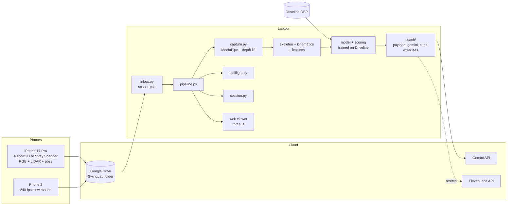
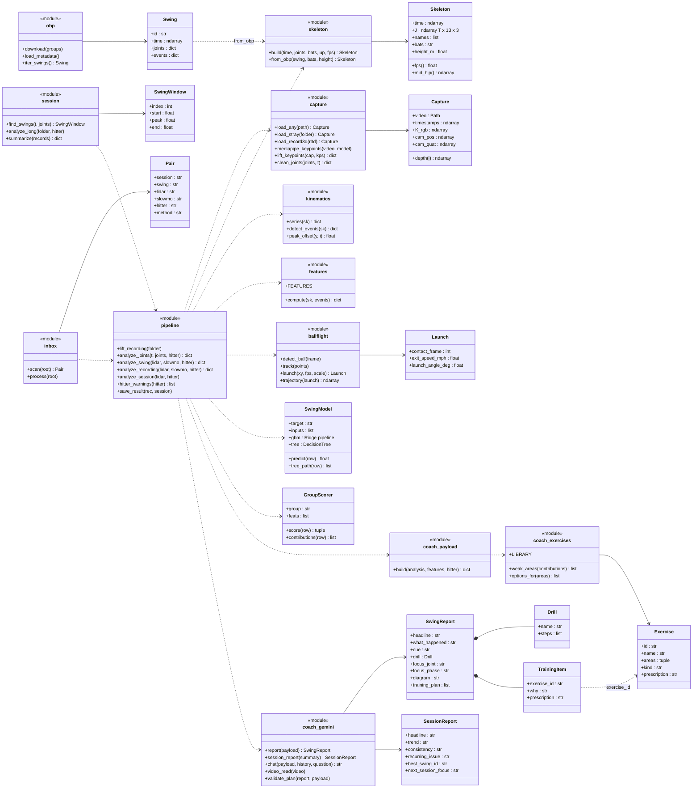
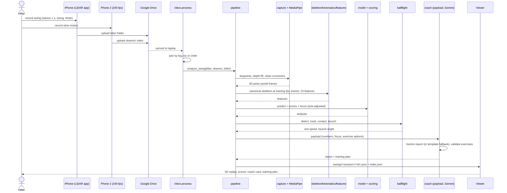
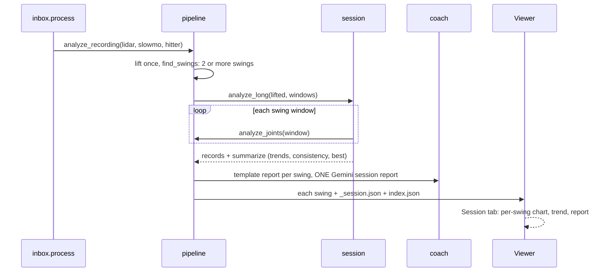

# SwingLab — Project Specification

Hack Knight 2026 · Adrian & Wilson · version 1.0, 2026-10-09 (Friday night)

Companion documents: `docs/FILES.md` (file guide) · viewer artifact "SwingLab Viewer" · `README.md`.
Status legend: ✅ built and tested · ⚠️ built, not yet run on real recordings ·
❌ not built.

---

## 1. Project idea

Film a baseball swing with an iPhone Pro (video + LiDAR depth) and a second
phone in 240 fps slow motion. SwingLab rebuilds the hitter in 3D, measures the
mechanics that drive bat speed and solid contact, rates the swing against 677
swings recorded in Driveline Baseball's motion-capture lab, measures the ball
off the bat, and uses Gemini to explain what to fix with a cue, a drill,
diagrams and a training plan. A whole batting-cage session in one long video is
split into swings automatically and tracked over time.

**Who it's for:** high-school and college hitters practicing without a coach;
coaches who want numbers for each player; anyone with an iPhone Pro and a tee.

**Why it's different:** phone apps measure 2D angles, which are distorted by
camera position, and stop at numbers. SwingLab measures in 3D in meters and
learns from lab swings with real outcomes what actually produces bat speed and
hard contact for a hitter's size.

**Target tracks:** Best Use of Gemini API (core) · Best Overall · Best Health
Hack (training plans, fatigue) · Best Use of ElevenLabs (stretch) · Best Use of
Presage (stretch) · Best Domain Name (GoDaddy Registry).

### Use cases

| # | Use case | Input | Output |
|---|---|---|---|
| U1 | Analyze one swing | One LiDAR recording (+ optional slow-motion clip) | 3D replay, 3 scores, predicted (and measured) speeds, coach report, drill, training plan |
| U2 | Batting-cage session | One long LiDAR recording with many swings (+ optional clips) | Every swing analyzed, session trends (bat speed, scores, fatigue), consistency, recurring issue, session report |
| U3 | Progress over time | Several sessions | Trend across sessions (planned) |
| U4 | Coach review | Shared viewer link / overlay video | Annotated video + numbers per player |

### The hitter profile (entered once per hitter)

| Field | Why it's needed | Used in |
|---|---|---|
| Bats R/L | Maps left/right joints to lead/rear; mirrors lefties | skeleton |
| **Height** | Distances are divided by height; size changes expected bat speed (~0.4 mph per inch in the lab data) | features, models, scores |
| **Weight** | ~0.85 mph per 10 lb in the lab data | models, scores |
| Age | ~0.2 mph per year | models, scores |
| Playing level | ~1.5 mph per level (HS → college → independent → MiLB) | models, scores |
| Bat length / weight | Recorded for later use (Driveline has it) | not used yet |

How size is corrected for (implemented):
1. **Normalization:** every distance feature (stride, stance width, head and
   hip drift, hands out in front) is divided by height.
2. **Prediction:** bat-speed and exit-velocity models take height, weight,
   age and level as inputs alongside the mechanics.
3. **Scores:** each score is a percentile of the *size-adjusted* outcome
   (the part of bat speed not explained by height, weight, age, level), so a
   small player with good mechanics can score high.
4. **Explanations and targets:** the explanation trees and the "top third"
   reference bands are also built on size-adjusted bat speed.
5. **Range check:** Driveline hitters were 1.60–1.96 m, 63.5–118 kg, 17–31
   years. Outside that range the app warns that speed predictions are
   extrapolated (mechanics comparisons still apply). Missing weight or age
   are filled with 80 kg / 20 years and flagged.

---

## 2. Goals

Each goal lists: user interaction, data, models and tools, outputs, what is
built, what remains, and how we'll know it works.

### Goal 1 — Measure and rate the swing in 3D (core)

**User interaction**
1. Set the iPhone (Record3D or Stray Scanner) on a tripod 3–4 m away, facing the
   hitter's chest, angled toward the catcher's side.
2. Hitter sets up and holds the stance ~1 s, swings, holds the finish.
3. Upload (shared folder, section 2.5) or run `analyze_capture.py`.
4. Open the viewer: 3D replay (orbit, ¼ speed, phase jumps), Power /
   Transfer / Contact scores, predicted bat speed and exit velocity, each
   measurement against the lab's top third, kinematic-sequence chart.

**Data**
- Training: Driveline OpenBiomechanics hitting set: 677 swings, 98 hitters,
  360 Hz joint centers in meters, force-plate foot plant, contact time, bat
  speed, exit velocity, HitTrax launch angle (verified free, no login).
- Inference: Record3D `.r3d` (JPG frames, LZFSE float32 depth, poses in `metadata`) or Stray Scanner recording (RGB video, 16-bit depth 256×192 per
  frame, confidence maps, per-frame camera pose and intrinsics) + hitter
  profile.

**Models and tools**
| Step | Tool / model | Trained by us |
|---|---|---|
| 2D body keypoints | MediaPipe Pose Landmarker (Tasks API, heavy model) | No |
| 2D → 3D | LiDAR depth sampling (nearer half of a 5×5 window) + back-projection with per-frame intrinsics and camera pose (ARKit world frame) | No |
| Occlusion repair | Rolling-median outlier rejection + interpolation (`clean_joints`) | No |
| Canonical skeleton | Lead/rear naming, body frame from the stance, floor at 0, lefties mirrored, resampled to the training frame rate | No |
| Swing events | Load, foot plant (ankle lift), contact (peak hand speed + 65 ms) | Offsets fitted on Driveline |
| Mechanics | 23 features: rotation speeds and ranges, separation, sequencing (sub-frame peak timing), stride, lead-knee block, trunk tilt, head/hip drift, hands out front | No |
| Prediction | Ridge regression: bat speed, exit velocity (mechanics + size) | **Yes**, Driveline, athlete-grouped CV |
| Scores | Per-group ridge on size-adjusted outcome → percentile | **Yes** |
| Explanation | Depth-3 decision trees on size-adjusted outcome, actionable mechanics only | **Yes** |

**Outputs:** scores 0–100 (Power, Transfer, Contact, Overall), predicted bat
speed / exit velocity, the costliest mechanic in mph ("focus"), tree path,
every measurement vs. lab range and top-third band, warnings.

**Built:** ✅ Driveline pipeline, events, features, models, scores, focus,
viewer. ⚠️ MediaPipe + LiDAR lift on real recordings (verified only on
synthetic recordings rendered from known 3D joints, where every feature
matches ground truth; timing features within 20 ms).

**Validated numbers (30 fps):** contact within 50 ms on 100% of 677 swings
(median 9 ms); foot plant within 50 ms on 70% (median 22 ms); our pelvis
speed vs Driveline's r = 0.93–0.97; lead-knee bend r = 0.99; bat speed
R² 0.31, ±3.1 mph (guessing the average: ±3.8); exit velocity R² 0.15,
±5.1 mph (±5.7).

**Remaining:** run on real captures; set the real depth frame rate and
retrain; check bone-length stability; resolve the left-handed static-angle
discrepancy vs Driveline; optional handheld (moving camera) capture.

**Done when:** a real swing produces stable bone lengths (±10%), features
inside plausible ranges, and the deliberate-flaw swings (arms only, early
shoulders, lunge, bent front leg, no stride) each lower the expected score
and trigger the expected focus.

### Goal 2 — Bat, ball and contact (second camera)

**User interaction:** a second phone films 240 fps slow motion from the side,
perpendicular to the ball's path, level with the tee; a yardstick at the tee is
filmed once per setup for scale; bright tape on the bat end. Files go to the
same shared folder; pairing is automatic.

**Data:** 240 fps video; scale (yardstick or ball diameter 7.37 cm); tee
position. Driveline reference: bat speed at contact, attack angle, HitTrax
launch angle and point of impact.

**Models and tools:** OpenCV ball detection (bright round blob + half-level
radius refinement), path tracking, contact = ball leaves the tee, exit speed
and launch angle from the first ~8 frames with gravity built into the fit,
ballistic trajectory (optional drag) for drawing. Next: bat-tip tracking for
bat speed at contact and contact point on the bat; stereo with two slow-motion
phones (stretch).

**Outputs:** contact frame/time, exit speed (tee), launch angle, projected
trajectory; next: bat speed at contact (compared with the model's prediction),
contact point relative to the body and on the bat.

**Notes:** real baseballs off a tee leave slower than Driveline's (their balls
came in at ~65 mph), so tee exit speed is compared swing to swing; bat speed
at contact is directly comparable. A single side camera measures speed in the
image plane (reads low if the ball moves toward or away from it).

**Built:** ✅ math + video path on a rendered 240 fps clip (exit speed within
2.5%, launch angle within 1°); measured exit speed flows into the Gemini
payload and the viewer. ⚠️ not yet on real video. ❌ bat-tip tracking, contact
point on the bat, early/late proxy, trajectory overlay drawing.

**Done when:** on real clips the ball is found in > 80% of post-contact frames,
and measured bat speed is within ~10% of the model's prediction on average for
our own swings.

### Goal 3 — Gemini coach: explanation, diagrams, training (core)

**User interaction:** after analysis, the viewer shows the coach card:
headline, what happened (with numbers), why it matters, one cue, one drill, a
training plan; a diagram chosen for the issue; later a chat box ("why does
that matter?", "drill without a bat?").

**Data:** the swing payload (scores, focus with mph cost, top costs and
strengths, measurements with labels and units, tree path, measured ball
numbers, weak training areas and matching exercise options, disclaimer).

**Models and tools:** Gemini API (`google-genai`, Flash model, structured
output against Pydantic schemas `SwingReport`, `SessionReport`, `VideoRead`);
prompts in `swinglab/coach/prompts/*.md`; template fallback for every call;
curated exercise library (22 movements, 8 training areas).

**Rules:** Gemini explains, never computes; only numbers in the payload;
associations, not promises; exercises only from the offered list (others are
dropped in code); diagrams are drawn by our code from real data, Gemini picks
which and writes the caption.

**Outputs:** report, focus joint and phase (viewer jumps there and rings the
joint), diagram choice + caption, training plan (3–4 exercises with
prescription and why), session report (goal 4).

**Built:** ✅ payload, schemas, prompts, Gemini client (report, session
report, chat, video read), fallback templates, training library and
validation, viewer coach card and training plan, 3D ghost of the fastest lab
swing, sequencing chart, top-third bands. ⚠️ live Gemini calls (key exists, not
yet run). ❌ chat box in the viewer, video second opinion wired into the
pipeline, Gemini-chosen diagram switching, "target pose" ghost, ElevenLabs
read-out.

**Done when:** 10 real swings get valid structured reports; every number in
the report text appears in the payload (automated check); invented exercises
never reach the UI; fallback works with a bad key.

### Goal 4 — Sessions and long videos (batting-cage mode)

**User interaction:** start one long LiDAR recording, take many swings with
pauses between them, upload. The app finds each swing, analyzes it, and the
Session tab shows bat speed and score per swing in order, first-third vs
last-third averages, trend per 10 swings, consistency of key mechanics, the
recurring issue, the best swing, and a Gemini session report (with a fatigue
note when bat speed drops late).

**Data:** any recording; the app counts the swings in it (1 swing → single analysis, 2+ → session), regardless of length;
optional per-swing slow-motion clips.

**Models and tools:** swing finder on 3D hand speed (peak ≥ 3.5 m/s, swings
≥ 2 s apart, window 1.6 s before to 0.8 s after the peak), the same per-swing
analysis, `session.summarize`, Gemini `session_report` (one call per session;
per-swing reports use the instant template to save API quota, with Gemini per
swing optional).

**Built:** ✅ swing finder (exactly one swing found in each of the 677 lab
clips; correct count and times on synthetic long recordings), per-swing
analysis, summary, session report + template, shared-folder auto-split,
viewer Session tab (demo session from one Driveline hitter's 9 swings).
⚠️ real long recordings. ❌ pairing many slow-motion clips with swings inside one
long recording, practice-swing vs. real-swing labeling, cross-session progress
view, faster pose for long videos.

**Notes:** MediaPipe on a 25-minute 60 fps video is ~90k frames (tens of
minutes on a laptop CPU). Planned speed-up: find swings first from cheap
frame differencing, run pose only on the windows.

**Done when:** a real 10-swing recording yields 10 analyzed swings with no
false swings from walking or practice motions, and the session view loads.

### Goal 5 — Capture and data pipeline (from phones to results)

**User interaction:** both phones upload to one Google Drive folder
(`SwingLab/sessions/<date>/lidar` and `/slowmo`); Google Drive for desktop
syncs it to the laptop; `process_inbox.py <folder> --watch` analyzes anything
new; results appear in the viewer. Optional `log.csv` gives exact pairing,
hitter and the swing's set (e.g. "flaw: arms only"). `hitters.csv` holds
profiles.

**Built:** ✅ inbox scan, unzip, pairing (log or order, mismatch flagged),
processed-state tracking, per-stage status, session auto-split, index for the
viewer, `check_recording.py` for new files. ⚠️ real Drive sync and real
exports (Stray Scanner, slow-motion originals). ❌ local upload page (phone
browser → laptop over Wi-Fi), "Process" button in the viewer.

### Goal 6 — Stretch: voice and vitals

- **ElevenLabs** reads the headline, cue and session summary aloud. ❌
- **Presage** measures heart and breathing rate from a webcam on the face
  **between** swings (unreliable during the swing): composure before a swing,
  heart-rate recovery, heart rate vs. bat speed across a session (fatigue).
  The payload already has a `vitals` slot. ❌

### Goal 7 — Pitching (after goals 1–3)

Same pipeline with Driveline's 411 fastballs (100 pitchers, pitch speed,
same landmark format, already named lead/rear/throwing arm). New: joint
mapping, events (foot plant, max external rotation, release), features,
target pitch speed, viewer mode. Capture a few throws at the field anyway.
Data download verified; ❌ processing.

---

## 3. Data sources

| Source | Status | Used for |
|---|---|---|
| Driveline OBP hitting (677 swings) | ✅ downloaded, checksummed, modeled | training, validation, demo |
| Driveline OBP pitching (411 pitches) | ✅ downloadable | goal 7 |
| Driveline OBP-CV videos (multi-camera, iPhone 240 fps, sample markerless outputs) | exists, contents unchecked | optional MediaPipe / ball-tracker validation |
| Our recordings (field, Saturday) | planned | testing, tuning, demo |
| Exercise library | ✅ curated in code | training plans |

License: Driveline data is CC BY-NC-SA 4.0 with an exclusion for people tied
to pro sports organizations or financial firms; non-commercial student use is
fine; credit Driveline in the submission.

---

## 4. Architecture

### 4.1 Components

### 4.2 Class diagram (UML)

### 4.3 Sequence: one swing from both phones to the viewer

### 4.4 Sequence: long batting-cage video

### 4.5 Data the viewer reads

`web/data/demo.json` (lab demo swings, reference ghost, population and
top-third ranges, demo session, pipeline status) · `web/data/index.json` (list
of analyzed swings and sessions) · `web/data/swings/<session>/<id>.json` (one
swing) · `web/data/swings/<session>/_session.json` (session summary).

---

## 5. Non-functional requirements

- **Runs on Windows laptops** (Python 3.12, PowerShell); pure-Python data
  download; no paid software required (Stray Scanner is free; Record3D RGBD export is $2.99).
- **Works offline** except Gemini/ElevenLabs; every AI call has a template
  fallback; the viewer has a single-file build.
- **Honest numbers:** every metric validated against ground truth where it
  exists; status table kept current; associations described as such.
- **Safety:** training plans come from a vetted list with a disclaimer;
  camera placement keeps phones out of the ball's path.
- **Privacy:** recordings stay in the team's own Drive and laptop; only the
  numeric payload (and optionally a short clip for the video read) goes to
  Gemini.
- **Test and verify:** 41 automated tests (synthetic + real-data);
  nothing is marked done until it has run on real input.

---

## 6. Status summary

| Area | Status |
|---|---|
| Driveline data, skeleton, events, features | ✅ |
| Models, scores, focus, top-third reference, size correction + range warnings | ✅ |
| Phone LiDAR path (lift, occlusion repair, resample) | ⚠️ synthetic only |
| Slow-motion ball speed and launch | ⚠️ synthetic video only |
| Bat speed / contact point on the bat | ❌ |
| Gemini report, session report, training plan, fallback | ✅ offline · ⚠️ live |
| Gemini chat, video read in the UI | ❌ |
| Long video → swings → session trends | ✅ synthetic + lab · ⚠️ real |
| Shared-folder pipeline | ✅ synthetic · ⚠️ real Drive |
| Viewer (swing, session, status tabs) | ✅ |
| Overlay video (inspiration-style HUD) | ❌ |
| Upload page | ❌ |
| ElevenLabs, Presage, pitching | ❌ |

## 7. Demo plan

1. Overlay video of a real swing (skeleton, angles, HUD, ball trajectory).
2. Viewer: 3D replay with ghost, scores, measured vs. predicted, coach card,
   training plan.
3. Session tab: a cage session with trend and Gemini session report.
4. Pipeline status tab: what's validated and how.
5. Pitch: "2D angles are distorted and don't say what to change; we measure in
   3D and learn from 677 lab swings what produces bat speed for your size."

## 8. Risks

| Risk | Mitigation |
|---|---|
| LiDAR depth patchy in sun | 3–4 m, shade, check first clip |
| MediaPipe misses wrists at full speed | occlusion repair; try heavier model / RTMPose |
| Phone depth frame rate lower than assumed | set `SWINGLAB_PHONE_FPS`, retrain (1.5 min) |
| Gemini rate limits | one session report per session; templates per swing; caching |
| Slow-motion export loses 240 fps | export originals; checker flags it; `--fps 240` |
| Small lab sample (98 hitters) | report associations, show uncertainty, size warnings |
